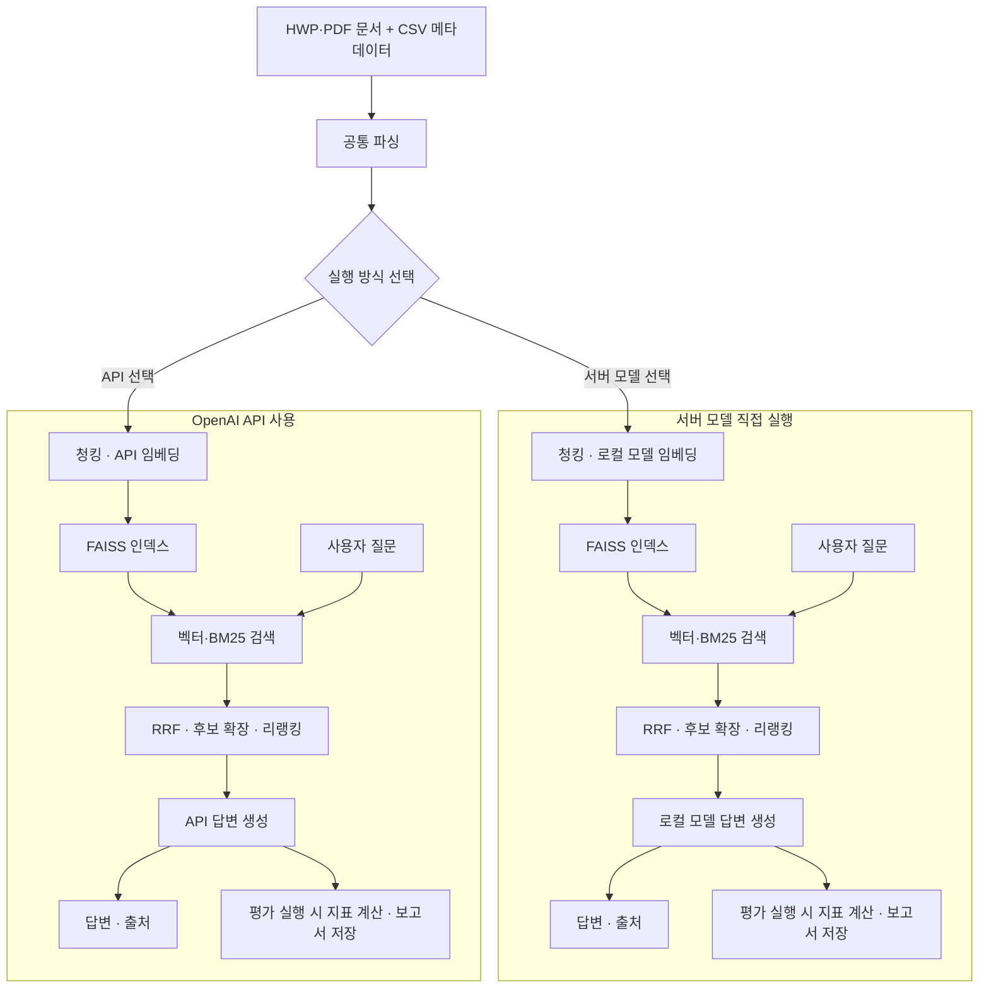

# RFP-RAG

> 코드잇 AI 중급 프로젝트 · 3팀
>
> RFP(제안요청서) 문서 기반 정보 검색·요약 및 질의응답 시스템

## 일정

| 구분 | 일정 |
| --- | --- |
| 프로젝트 진행 기간 | 2026.09.29 ~ 2026.10.22 |

## 프로젝트 개요

공공입찰 컨설팅 서비스 ‘입찰메이트’의 사내 RAG 시스템 구축을 주제로 진행하는 프로젝트입니다. 컨설턴트가 수십 페이지의 제안요청서를 일일이 읽는 부담을 줄이고, 고객사에 적합한 입찰 기회를 검토하는 데 필요한 정보를 제공하는 것을 목표로 합니다.

제공된 RFP 문서 100개와 메타데이터를 활용하여 파싱, 청킹, 임베딩, 검색, 답변 생성 및 평가를 진행합니다. 현재 실행 형태는 Python CLI이며, 질문과 관련된 문서 근거를 검색하고 출처 번호가 포함된 답변을 생성합니다.

| 항목 | 내용 |
| --- | --- |
| 입력 데이터 | RFP 문서(HWP, PDF), `data_list.csv` 메타데이터 |
| 주요 기능 | 문서 파싱, 메타데이터 필터링, 하이브리드 검색·리랭킹, 근거 기반 요약·질의응답 |
| 서버 모델 실행 | GCP GPU 서버에서 임베딩·생성 모델 직접 실행 |
| OpenAI API 사용 | OpenAI API로 임베딩·생성, 서버에서 검색·리랭킹 |
| 비교 실행 | 서버 모델과 API를 차례로 평가하고 터미널에 비교표 출력 |
| 최종 산출물 | 재현 가능한 코드, 분석 보고서, 개인별 협업일지 |

## 처리 흐름과 구조



선택한 실행 방식의 흐름을 사용합니다. 두 방식 비교를 선택하면 서버 모델 실행이 끝난 뒤 API를 실행합니다.

```text
rfp-rag/
├── run.py                         # 실행 방식 선택·가상환경 실행·평가 비교표
├── pipelines/
│   ├── server/                    # 서버 모델 직접 실행
│   │   ├── server_run.py          # 서버 파이프라인 실행
│   │   ├── server_embedding.py    # 청킹·로컬 임베딩·인덱스
│   │   ├── server_retrieval.py    # 검색·리랭킹
│   │   ├── server_generation.py   # 답변 구성
│   │   ├── server_client.py       # 로컬 모델 연결
│   │   ├── server_local_embedding.py
│   │   └── server_local_generation.py
│   └── api/                       # OpenAI API 사용
│       ├── api_run.py             # API 파이프라인 실행
│       ├── api_embedding.py       # 청킹·API 임베딩·인덱스
│       ├── api_retrieval.py       # 검색·리랭킹
│       └── api_generation.py      # API 답변 생성
├── parsing/parsing_documents.py   # 공통 문서 파싱
├── evaluation/evaluation_metrics.py # 공통 평가·판정기
├── observability/observability_trace.py # 추적·로깅
├── tracking/
│   ├── tracking_ids.py            # 실행 번호 관리
│   └── tracking_reports.py        # 해시·요약 보고서
├── retrieval/retrieval_query_rewrite.py # 질문 재작성
├── config/config_paths.py         # 프로젝트·모델 경로 설정
├── data/raw/                      # 원본 files/와 data_list.csv
├── data/processed/common/         # 공통 파싱 결과
├── models/                        # 생성·임베딩·리랭커 모델
├── indexes/server/ , indexes/api/        # 실행 방식별 인덱스
├── results/server/ , results/api/        # 실행 결과·reports/
├── docs/LANGFUSE_GUIDE.md         # 선택적 추적 설정 안내
├── requirements-server.txt             # 서버 모델 환경 고정 버전
├── requirements-api.txt             # API 환경 고정 버전
└── .env.server.example / .env.api.example
```

서버 모델과 API 코드는 각각 `pipelines/server/`, `pipelines/api/`에서 관리하며 파일에도 `server_`·`api_` 접두사를 사용합니다. 공통 기능은 역할별 패키지에서 함께 사용합니다.

## 팀원 및 역할

| 담당 역할 | 이름 | GitHub | 협업일지 |
| --- | --- | --- | --- |
| PM / 통합 | 김도영 | [@diokim17](https://github.com/diokim17) | [협업일지](https://docs.google.com/document/d/1UcFhq4vEb1SL2uDldYpeGibJ07wi1n34tP9XeckNyWs/edit?tab=t.ka3ijil7t5i2) |
| 파싱 / 전처리 | 나상훈 | [@Na-SangHun](https://github.com/Na-SangHun) | [협업일지](https://docs.google.com/document/d/1UcFhq4vEb1SL2uDldYpeGibJ07wi1n34tP9XeckNyWs/edit?tab=t.4bl1rvpraiza#heading=h.qv2phv602y3p) |
| 청킹 / 임베딩 | 유찬혁 | [@jins091125-gif](https://github.com/jins091125-gif) | [협업일지](https://docs.google.com/document/d/1UcFhq4vEb1SL2uDldYpeGibJ07wi1n34tP9XeckNyWs/edit?tab=t.g14lnaobk5xt#heading=h.xrtl9g9gkphg) |
| 검색 고도화 | 김연주 | [@AIengineeung](https://github.com/AIengineeung) | [협업일지](https://docs.google.com/document/d/1UcFhq4vEb1SL2uDldYpeGibJ07wi1n34tP9XeckNyWs/edit?tab=t.sj1bxo9tvmqa#heading=h.qo3mm8oq6yi) |
| 생성 / LLM | 박단비 | [@DBDBDEEP02](https://github.com/DBDBDEEP02) | [협업일지](https://docs.google.com/document/d/1UcFhq4vEb1SL2uDldYpeGibJ07wi1n34tP9XeckNyWs/edit?tab=t.u2cla8e84xyr#heading=h.tg7gi3kx1lvh) |
| 평가 | 김시현 | [@dypower1559-cell](https://github.com/dypower1559-cell) | [협업일지](https://docs.google.com/document/d/1UcFhq4vEb1SL2uDldYpeGibJ07wi1n34tP9XeckNyWs/edit?tab=t.lijv4uvh1zh6#heading=h.qi25fkhl73oj) |

### 데일리 스크럼

[데일리 스크럼 일지](https://docs.google.com/document/d/1UcFhq4vEb1SL2uDldYpeGibJ07wi1n34tP9XeckNyWs/edit?tab=t.ka3ijil7t5i2)

매일 10~15분 동안 어제 한 일, 오늘 할 일, 이슈를 공유합니다.

## 개발 환경 및 기술 스택

팀 실행 기준은 Python 3.12.3 / GCP Linux x86_64 / NVIDIA L4입니다. 서버 생성 모델 로더는 CUDA GPU를 사용하며, API 방식도 cross-encoder 리랭킹에 GPU 사용을 권장합니다.

| 공통 항목 | 사용 기술 |
| --- | --- |
| 문서 파싱 | PyMuPDF, olefile 기반 공통 파서 |
| 평가·추적 | 공통 평가 모듈, 선택적 OpenAI 판정기·Langfuse |

| 구분 | 서버 모델 실행 | OpenAI API 사용 |
| --- | --- | --- |
| 임베딩 | 로컬 BGE-M3 (팀 권장안) | `text-embedding-3-small` |
| 생성 모델 | 로컬 EXAONE | `gpt-5-mini`  |
| 검색 | FAISS, BM25, RRF, 후보 확장·리랭킹 | 동일한 구성, 실행 방식별 구현·설정 |
| 청킹 방식 | 고정 길이 청킹 + 문서 개요 청크 추가 | 문서 구조 기반 청킹 |
| 추론 패키지 | `transformers==5.1.0` | `transformers==4.57.1` |

설치 기준은 [requirements-server.txt](requirements-server.txt)와 [requirements-api.txt](requirements-api.txt)이며, 패키지 버전이 달라 가상환경을 분리합니다.

## 실행 방법

프로젝트 루트에서 아래 순서대로 진행합니다.

1. 저장소 클론
2. 사용할 방식의 가상환경·패키지 설치
3. 서버 모델 사용 시 `models/`에 모델 다운로드
4. `data/`에 원본 데이터 배치
5. `.env.server` 또는 `.env.api` 설정
6. `run.py` 실행

### 1. 저장소 준비

새 환경에서는 아래 미리보기 브랜치를 받습니다. 아직 `main`에는 반영하지 않은 실행용 구성입니다. 아래 명령은 Linux Bash 기준입니다.

```bash
git clone --branch release/main-preview-dy https://github.com/diokim17/rfp-rag.git
cd rfp-rag
python3.12 --version
nvidia-smi
```

원본 데이터와 모델 파일은 저장소에 포함되지 않습니다. 아래 단계에 따라 별도로 준비하세요.

### 2. 가상환경 설정

사용할 실행 방식의 환경만 설치해도 됩니다. 두 방식을 함께 실행하려면 두 환경을 모두 준비합니다. 가상환경 생성과 패키지 설치는 최초에 수동으로 한 번 진행하며, 자동 설치되지 않습니다.

**서버 모델 직접 실행**

```bash
python3.12 -m venv .venv-server
.venv-server/bin/python -m pip install -r requirements-server.txt
.venv-server/bin/python -m pip check
```

**OpenAI API 사용**

```bash
python3.12 -m venv .venv-api
.venv-api/bin/python -m pip install -r requirements-api.txt
.venv-api/bin/python -m pip check
```

서버 모델은 `.venv-server`, API는 `.venv-api` 환경에서 실행합니다. 두 설치 파일은 CUDA 12.6용 PyTorch 패키지 경로를 포함합니다. 각 환경에는 위에서 안내한 설치 파일을 사용하세요.

### 3. 서버 모델 다운로드

**OpenAI API만 사용한다면 이 단계는 건너뜁니다.** API 방식의 검색용 리랭커는 첫 실행 시 Hugging Face에서 별도로 내려받을 수 있으므로 인터넷 연결과 저장 공간이 필요합니다.

서버 모델은 프로젝트 루트에서 아래 명령으로 다운로드합니다. 설치한 서버용 가상환경의 `huggingface_hub`를 사용하며, 기존 실행 환경에서 확인한 commit revision으로 버전을 고정합니다. 사용 전 각 모델 저장소의 이용 조건을 확인하세요.

| 용도 | Hugging Face 저장소 | 저장 위치 |
| --- | --- | --- |
| 답변 생성 | [LGAI-EXAONE/EXAONE-3.5-7.8B-Instruct](https://huggingface.co/LGAI-EXAONE/EXAONE-3.5-7.8B-Instruct) | `models/generate/generation_model/` |
| 임베딩 | [BAAI/bge-m3](https://huggingface.co/BAAI/bge-m3) | `models/embedding/default_model/` |
| 리랭킹 | [BAAI/bge-reranker-v2-m3](https://huggingface.co/BAAI/bge-reranker-v2-m3) | `models/rerank/bge-reranker-v2-m3/` |

먼저 `df -h .`로 여유 공간을 확인하세요. 생성 모델을 포함한 가중치는 수십 GB 규모이므로 다운로드 중 임시 파일과 가상환경까지 고려해 공간을 확보해야 합니다.

```bash
.venv-server/bin/python - <<'PYMODELS'
from huggingface_hub import snapshot_download

models = [
    ("LGAI-EXAONE/EXAONE-3.5-7.8B-Instruct",
     "553ea250b9a5317231459279d5847d6cf955b9aa",
     "models/generate/generation_model"),
    ("BAAI/bge-m3",
     "5617a9f61b028005a4858fdac845db406aefb181",
     "models/embedding/default_model"),
    ("BAAI/bge-reranker-v2-m3",
     "953dc6f6f85a1b2dbfca4c34a2796e7dde08d41e",
     "models/rerank/bge-reranker-v2-m3"),
]
for repo_id, revision, destination in models:
    patterns = ["*.json", "*.safetensors", "*.model", "*.txt", "*.py", "*.md"]
    if repo_id == "BAAI/bge-m3":
        patterns.append("pytorch_model.bin")
    snapshot_download(
        repo_id=repo_id,
        revision=revision,
        local_dir=destination,
        allow_patterns=patterns,
    )
    print(f"다운로드 완료: {destination}")
PYMODELS
```

가중치와 모델 실행에 필요한 설정·토크나이저·Python 파일만 받아 다른 형식의 중복 가중치 다운로드를 줄입니다. 같은 명령을 다시 실행하면 다운로드 메타데이터를 사용해 필요한 파일을 확인합니다. 인증이 필요한 경우 아래 명령으로 본인의 Hugging Face 계정에 로그인한 뒤 다시 실행하세요. 토큰은 저장소에 커밋하지 않습니다.

```bash
.venv-server/bin/hf auth login
```

다운로드 후 폴더 구조는 다음과 같습니다. 모델 파일은 Git에 올라가지 않습니다.

```text
rfp-rag/
├── data/
├── models/
│   ├── generate/generation_model/
│   ├── embedding/default_model/
│   └── rerank/bge-reranker-v2-m3/
└── run.py
```

### 4. 데이터 준비

```text
data/raw/
├── data_list.csv
└── files/
    ├── <RFP 문서>.hwp
    └── <RFP 문서>.pdf
```

CSV에는 `파일명` 열이 필요하며 `files/` 안의 실제 파일명과 일치해야 합니다. 파싱 시 본문 중복 문서는 하나로 합쳐질 수 있어 입력 파일 수와 최종 문서 수는 다를 수 있습니다. 실패·중복 내역은 `data/processed/common/parsing_errors.json`에서 확인합니다.

### 5. 환경 변수 설정

사용할 방식의 예시 파일을 복사합니다. 아래 명령은 기존 설정 파일을 덮어쓰지 않습니다.

```bash
test -f .env.server || cp .env.server.example .env.server
test -f .env.api || cp .env.api.example .env.api
```

| 실행 방식 | 설정 파일 | 입력할 내용 |
| --- | --- | --- |
| 서버 모델 | `.env.server` | 위 다운로드 경로를 사용하면 추가 입력 없음 |
| OpenAI API | `.env.api` | 본인의 `OPENAI_API_KEY` |

모델 설정은 예시 파일의 기본값을 사용합니다. 서버 모델에서 OpenAI 평가 판정기를 사용할 때는 `.env.server`에도 `OPENAI_API_KEY`를 입력하세요.

**선택 설정**

- 모델 위치 변경: `.env.server`의 `SERVER_MODELS_DIR`에 `../shared-models` 같은 프로젝트 기준 상대 경로를 지정합니다. 해당 폴더에 `generate/`, `embedding/`, `rerank/` 구조와 접근 권한이 필요합니다.
- 실행 기록 구분: `EXPERIMENT_OWNER` 또는 `--owner`에 영문 이름(2~16자)을 지정합니다. 비우면 `user-0001` 형식으로 실행 번호를 생성합니다.
- 외부 추적: Langfuse 키를 비우면 로컬 결과만 저장합니다. 필요한 경우 [Langfuse 가이드](docs/LANGFUSE_GUIDE.md)에 따라 설정하세요.

준비한 환경의 설정을 확인합니다. 모델 추론·API 호출은 없으며, 모델 파일이나 API 키의 유효성까지 검증하지는 않습니다.

```bash
.venv-server/bin/python -m pipelines.server.server_run check-config
.venv-api/bin/python -m pipelines.api.api_run check-config
```

프로세스 환경변수는 설정 파일보다 우선합니다. 실행 방식별 설정은 `.env.server`·`.env.api`에서 관리하고, 공통 `.env`에 중복 지정하지 마세요.

### 6. 서버 모델 / API 선택 실행

프로젝트 루트에서 실행합니다. 가상환경을 활성화하지 않아도 `run.py`가 선택한 실행 방식의 Python으로 별도 프로세스를 실행합니다.

```bash
python3.12 run.py check-config
```

| 메뉴 입력값 | 실행 방식 |
| --- | --- |
| `1` 또는 `server` | 서버 모델 직접 실행 |
| `2` 또는 `api` | OpenAI API 사용 |
| `3` 또는 `server+api` | 두 방식 차례로 실행 |

터미널에서는 환경변수와 관계없이 항상 메뉴가 나옵니다. 위 입력값으로 실행 방식을 선택합니다. Enter만 누르면 공통 `.env` 또는 환경변수의 `RFP_SCENARIO` 값, 미설정 시 API 사용을 선택합니다. 입력을 받을 수 없는 배치 환경에서는 그 기본값으로 바로 실행합니다.

| 선택 | Python 탐색 순서 | 실행 환경 설정 |
| --- | --- | --- |
| 서버 모델 | `RFP_PYTHON_SERVER` → `.venv-server` → 현재 Python | `.env.server` |
| API | `RFP_PYTHON_API` → `.venv-api` | `.env.api` |
| 함께 실행 | 서버 모델 실행 후 API 실행 | 각 파일을 별도 프로세스에서 읽음 |

현재 코드는 가상환경을 찾지 못하면 현재 Python을 사용하므로 위 경로에 환경을 준비한 뒤 실행하세요. 다른 위치의 환경은 `RFP_PYTHON_SERVER`·`RFP_PYTHON_API`에 프로젝트 기준 Python 실행 파일의 상대 경로를 지정할 수 있습니다.

최초 전체 실행은 아래 순서로 진행합니다. 각 명령에서 실행 방식을 선택하세요. 공통 파싱은 한 번만 하면 되고, 실행 방식별 인덱스는 각각 구축합니다.

```bash
python3.12 run.py parse
python3.12 run.py build
python3.12 run.py ask --question "한영대학교 교육환경 구축 사업의 주요 요구사항은 무엇인가요?"
```

| 명령 | 동작 |
| --- | --- |
| `check-config` | 실행 환경 설정 읽기 확인 |
| `parse` | 원본 → 공통 `documents.json`, 파싱 오류 기록 |
| `build` | 전처리 문서 → 실행 방식별 청킹·임베딩·FAISS 인덱스 |
| `ask --question "질문"` | 기존 인덱스 검색 후 답변·출처 생성 |
| `all --question "질문"` | 파싱 → 인덱스 구축 → 질의응답 |
| `evaluate --eval-file 경로` | 평가셋 질문 실행·지표 저장 |

명령 없이 `python3.12 run.py`만 실행하면 실행 방식 선택 후 해당 인덱스가 있으면 `ask`, 없으면 `all`을 실행합니다. 질문과 문서 수는 `pipelines/server/server_run.py`·`pipelines/api/api_run.py`의 기본값을 사용하며 현재 `DEFAULT_LIMIT=3`입니다. 전체 데이터 구축은 위처럼 명령을 명시하고 `--limit`을 생략하세요. `all --limit 3`은 공통 전처리 파일도 3행 기준으로 다시 쓰므로 전체 데이터 실험과 섞지 마세요.

특정 기관으로 범위를 좁힐 때는 `--filter "발주 기관=기관명"`, 결과 청크 수는 `--top-k 5`를 사용합니다. 메뉴 없는 직접 실행은 `.venv-server/bin/python -m pipelines.server.server_run ...` 또는 `.venv-api/bin/python -m pipelines.api.api_run ...`로 할 수 있습니다.

### 7. 저장 경로와 재실행

| 산출물 | 경로 |
| --- | --- |
| 공통 전처리 문서·오류 | `data/processed/common/` |
| 실행 방식별 인덱스 | `indexes/server/`, `indexes/api/` |
| 질의·평가 결과 JSON | `results/server/`, `results/api/` |
| 실행별 요약 보고서 | `results/server/reports/`, `results/api/reports/` |
| 실험 번호 상태 | `.experiment-state/server/`, `.experiment-state/api/` |

파싱한 문서와 인덱스의 해시가 다르면 질의·평가가 중단됩니다. 같은 문서로 `build`를 다시 실행하거나 해당 인덱스와 일치하는 `--processed-dir`를 지정하세요.

임베딩 모델·청킹을 바꾸면 인덱스를 다시 구축합니다. 생성 모델만 바꿀 때는 기존 인덱스를 사용할 수 있습니다. 별도 데이터를 사용할 때는 `--processed-dir`, `--index-dir`, `--results-dir`, `--reports-dir`로 별도 경로를 지정하고 질의·평가에도 같은 문서와 인덱스 경로를 사용하세요. 두 방식을 함께 실행할 때는 같은 옵션이 양쪽에 전달되므로 `--index-dir`·`--results-dir`를 같은 경로로 강제하지 말고 기본 분리 경로를 사용하세요.

### 8. 평가 실행 (선택)

질의응답 사용에는 평가셋이 필요하지 않습니다. 팀 내부 평가셋은 제공하지 않습니다. 본인이 평가 JSON을 준비한 경우에만 아래 명령을 실행하세요. `data/my-evaluation.json`은 사용자가 준비할 파일의 예시 경로입니다.

```bash
python3.12 run.py evaluate \
  --eval-file data/my-evaluation.json \
  --judge-model gpt-5-nano
```

메뉴에서 `server`, `api`, `server+api` 중 하나를 선택합니다. 두 방식을 선택하면 서버 모델 실행이 끝난 뒤 API를 실행하고 터미널에 비교표를 출력합니다. 결과 JSON과 보고서는 각각 `results/server/`, `results/api/`에 저장합니다.

LLM 판정에는 선택한 실행 방식의 설정 파일에 `OPENAI_API_KEY`가 필요하며 추가 비용이 발생합니다. 판정 모델은 `gpt-5-nano` 또는 `gpt-5-mini`를 사용할 수 있습니다. 판정기를 생략하면 LLM 채점 대상 문항은 미채점됩니다. 단일 방식의 반복 평가에는 `--judge-cache`로 판정 캐시 경로를 지정할 수 있습니다.

## 최종 성능 평가

프로젝트 내부 평가에서 동일한 전처리 문서 98개와 평가 질문 50개(답변 가능 42개, 답변 불가 8개)를 사용해 각 실행 방식을 3회 평가했습니다. 판정 모델은 GPT-5 nano입니다.

| 실행 방식 | 문서 Recall@5 | MRR@5 | 평균 답변 점수 | 평균 내용 점수 | 답변 불가 질문 거절 | 평균 응답 시간 |
| --- | ---: | ---: | ---: | ---: | ---: | ---: |
| OpenAI API | 1.000 | 1.000 | 0.996 | 0.996 | 8/8 | 9.59초 |
| 서버 모델 | 1.000 | 1.000 | 0.849 | 0.897 | 7/8 | 15.55초 |

검색 지표는 답변 가능한 42문항 기준입니다. 답변·내용 점수는 3회 평균으로, 부분 정답을 포함한 자동 채점 점수이며 엄격한 정답률을 뜻하지 않습니다. 응답 시간은 질문 임베딩부터 답변 생성까지이며 평가 판정 시간은 제외합니다.

아래 수치는 내부 평가 기록이며, 실행에 필요한 입력 파일이나 평가셋을 제공하는 것은 아닙니다. 최종 보고서 초안에 정리된 평가 기록을 기준으로 작성했습니다. API는 `yjk-0004~0006`, 서버 모델은 `shn-0106~0108`의 결과이며, 최신 코드에서 이번 README 작성 중 다시 실행한 수치는 아닙니다. 서버 모델은 동일한 답변에도 자동 판정 점수가 달라질 수 있습니다.

## 결론 및 개선 사항

- **주요 성과:** 서버 모델·API 독립 환경을 공통 CLI로 연결하고 파싱·평가·추적 코드를 통합했습니다. 검색 근거와 답변 출처, 실행별 평가 결과로 변경 전후를 확인할 수 있습니다.
- **의사결정:** 서버 모델 실행은 고정 길이 청크에 문서 개요를 추가하고, API 사용은 문서 구조 기반 청킹을 적용합니다. 하이브리드 검색·리랭킹으로 세부 근거를 찾고, 문서 해시로 인덱스와 입력 문서의 불일치를 검사합니다.
- **현재 한계:** CLI는 실행별 질문을 처리하며 대화 이력 저장·연속 대화 기능은 제공하지 않습니다. 서버 모델은 GPU·로컬 모델 파일에 의존하고 API 사용과 판정기에는 API 비용이 발생합니다. 평가셋 재사용·단일 반복 측정으로 일반화 성능을 단정할 수 없습니다.
- **개선 방향:** 같은 평가셋·문서로 두 방식의 답변 품질·지연·비용을 함께 측정하고 남아 있는 문서·근거 누락을 보완합니다. 가상환경 누락 시 종료 안내, 모델 경로 설정, 배포·사용자 화면과 대화 이력은 후속 검토 항목입니다.
- **회고 정리:** 청킹·임베딩·검색 변경 시 근거 검색과 생성 결과를 나누어 확인합니다. 개인별 회고와 멘토링 내용은 협업일지에서 관리합니다.

## 결과물

| 구분 | 링크·상태 |
| --- | --- |
| GitHub Repository | [rfp-rag](https://github.com/diokim17/rfp-rag) |
| 실행별 평가 결과 | 로컬 `results/server/`, `results/api/`에 생성 |
| 최종 보고서 PDF | [보고서 보기](docs/reports/AI13기_3팀_중급프로젝트_보고서.pdf) · [보고서 다운로드](https://github.com/diokim17/rfp-rag/raw/refs/heads/main/docs/reports/AI13기_3팀_중급프로젝트_보고서.pdf) |
| 발표 자료 PDF | [발표 자료 보기](docs/reports/AI13기_3팀_중급프로젝트_발표자료.pdf) · [발표자료 다운로드](https://github.com/diokim17/rfp-rag/raw/refs/heads/main/docs/reports/AI13기_3팀_중급프로젝트_발표자료.pdf) |
| 개인별 협업일지 | [팀원 및 역할](#팀원-및-역할) |

## 데이터 및 보안

- 제공받은 원본 RFP 문서는 외부 공유가 금지되어 있으므로 저장소에 업로드하지 않습니다.
- API 키, SSH 키, `.env`·`.env.server`·`.env.api`, 모델 가중치는 커밋하지 않습니다.
- 결과 JSON에는 질문·답변·문서 근거가 포함될 수 있으므로 공유 전에 확인합니다. 팀 공유용 요약은 각 실행 방식의 `reports/`를 사용합니다.
- API 방식의 임베딩·생성과 OpenAI 판정기는 외부 API로 입력을 전송합니다. 서버 방식의 임베딩·생성은 로컬 모델을 사용하며 판정기·추적 사용 여부는 별도로 설정합니다.
